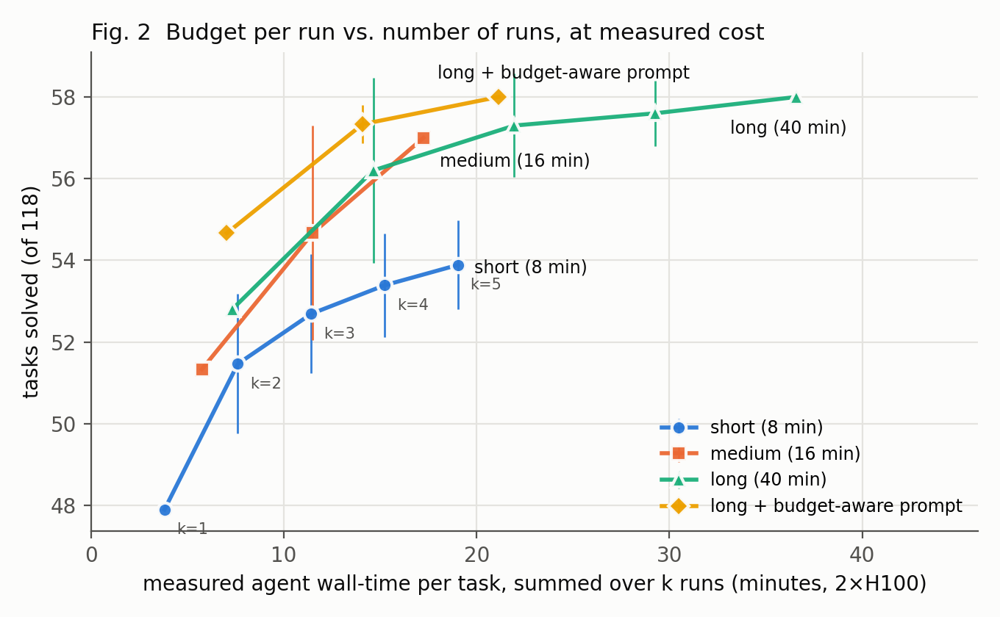

# More Seeds, More Steps, or a Better Pick?

Code, per-run results and figures for a [Gemma 4 Developer Agent Paper Track](https://www.kaggle.com/competitions/gemma-4-developer-agent-paper) entry. The question it answers: when a small local coding agent (Gemma 4 31B) has a fixed compute allowance per task, should the compute go to one run with a larger budget, or to several short runs with one patch picked without tests?

**Findings**, from 2,950 agent runs on the 118 gradeable competition tasks:

- **Budget per run beats more runs at matched measured cost.** One medium run (16-minute budget) solves 52.8 tasks, the same as one long run, at 5.7 vs 7.3 measured minutes per task. Two short runs plus a selector cost 7.6 minutes and solve 51.5.
- **A bigger budget works mainly by preventing wasted runs.** Runs that end without a usable patch fall from 20% (short) to 4% (long). Most of the extra budget is never spent.
- **Test-free selection overfits.** A pre-registered holdout on fresh seeds cut the selector's gain in half, to no more than a simple validity filter. Gemma 4 judging its own patches added nothing.
- **Single scores are noisy.** One run's score varies by about ±5 tasks across seeds.

The paper is [`paper/draft.md`](paper/draft.md). The version submitted to Kaggle is [`paper/kaggle_writeup.md`](paper/kaggle_writeup.md).



## Repository layout

| Path | Contents |
|---|---|
| `paper/` | Paper, Kaggle version, pre-registration of the holdout rules, figures and figure data (`figs/*.csv`) |
| `results/<run>/` | Per-run outputs for each regime: `seedN_task_results.jsonl` (official grader output per task) and `features.jsonl` (one row per task × seed with the selection features) |
| `results/*.txt`, `*.csv` | Summary tables used in the paper: frontier, noise, paired tests, usage, holdout, grader soundness |
| `code/selector/` | All analysis: feature extraction, selectors, Gemma judge, noise model, frontier, paired tests, figures |
| `code/hpc/` | Grader and agent runner for a Slurm cluster with Apptainer (no Docker, no root) |
| `code/agents/` | The four agent configurations (budget and prompt are the only differences) |

Runs in `results/`:

| Run | Regime | Seeds |
|---|---|---|
| `baseline` | short: 8 min, 28 tool calls, 80 turns (competition default) | 0–4 |
| `baseline_holdout` | short, fresh seeds for the pre-registered holdout | 5–9 |
| `baseline_medium` | medium: 16 min, 56 calls, 160 turns | 0–4 |
| `baseline_long` | long: 40 min, 140 calls, 400 turns | 0–4 |
| `long_thorough` | long, with a prompt that states the budget | 0–4 |

Raw agent traces and patches are not included because of their size and because they contain competition data. `features.jsonl` holds everything the analysis needs.

## Reproducing the paper's numbers and figures

No GPU is needed. This uses only the files in `results/`. You need Python 3.10+ and matplotlib:

```bash
pip install matplotlib
cd code/selector
R=../../results
```

| Paper item | Command |
|---|---|
| Table 2 (noise, minimum detectable difference) | `python noise.py short=$R/short10_features.jsonl medium=$R/baseline_medium/features.jsonl long=$R/baseline_long/features.jsonl thorough=$R/long_thorough/features.jsonl` |
| Table 3 (paired comparisons) | `python paired_tests.py $R` |
| Fig. 2 data, frontier | `python frontier.py short=$R/baseline/features.jsonl,$R/baseline_holdout/features.jsonl medium=$R/baseline_medium/features.jsonl long=$R/baseline_long/features.jsonl thorough=$R/long_thorough/features.jsonl` |
| Run usage, invalid-run share, per-repo scores | `python usage.py short=$R/baseline/features.jsonl,$R/baseline_holdout/features.jsonl medium=$R/baseline_medium/features.jsonl long=$R/baseline_long/features.jsonl thorough=$R/long_thorough/features.jsonl` |
| Pre-registered holdout (§5) | `python prereg_eval.py $R/baseline_holdout/features.jsonl $R/baseline_long/features.jsonl` |
| In-sample selector table (§5) | `python select_eval.py $R/baseline/features.jsonl` |
| Figures 1–3 | `python make_figs.py $R ../../paper/figs` |

Expected outputs are saved next to the inputs (`results/noise.txt`, `results/paired_tests.txt`, `results/frontier.txt`, `results/usage_by_regime.txt`, `results/prereg_holdout.txt`), so you can diff against them. Bootstrap and subset sampling use fixed seeds, so numbers reproduce exactly.

## Rerunning the agents (GPU)

This needs the competition's data and harness (accept the competition rules on Kaggle first), the Gemma 4 31B QAT weights, and a Slurm cluster with H100s and Apptainer. The scripts contain our cluster's paths and account names; adjust them before use.

1. Build images: `code/hpc/slurm/build_vllm_sif.sh` (vLLM 0.19.1), `code/hpc/build_sbx2.sh` (task sandbox, mirrors the public Dockerfile), `code/hpc/build_harness_sif.sh`.
2. Check the grader: `code/hpc/gate1_all.sh` applies gold and empty patches to all 129 tasks. Expect 120/129 and 2/129, which leaves 118 sound tasks (`results/gate1_soundness.csv`).
3. Run an agent: `sbatch code/hpc/agent_job.sh <run_name> code/agents/<config> 10 <seed> [seed ...]`. Each job uses 2×H100 (tensor parallel 2) and takes about 1.5–2.5 hours for 118 tasks.
4. Pull a finished run down and recompute everything: `bash code/selector/update_all.sh <run_name>`.

### Three grader fixes

The public setup gives wrong scores in three cases without raising any error. Our grader fixes all three:

1. **Package shadowing.** The bundled wheels include released versions of fastapi, rich, requests and httpx, which shadow the repository under test. 38 tasks "passed" with an empty patch. `task_env.py` leaves out the repository's own wheel.
2. **Version drift.** Installation always picks the newest of many bundled versions, such as 56 versions of starlette, which breaks old FastAPI snapshots. `task_env.py` picks the newest version that meets the repository's constraints and was released before the task was created.
3. **Stale cache.** The harness caches site-packages under a fixed name in `/tmp`, so jobs can silently reuse a wrong environment. `agent_job.sh` gives every job its own `TMPDIR`.

## License

Code and results: MIT (see [`LICENSE`](LICENSE)). Competition tasks and data are not redistributed here and remain under the competition's terms.
