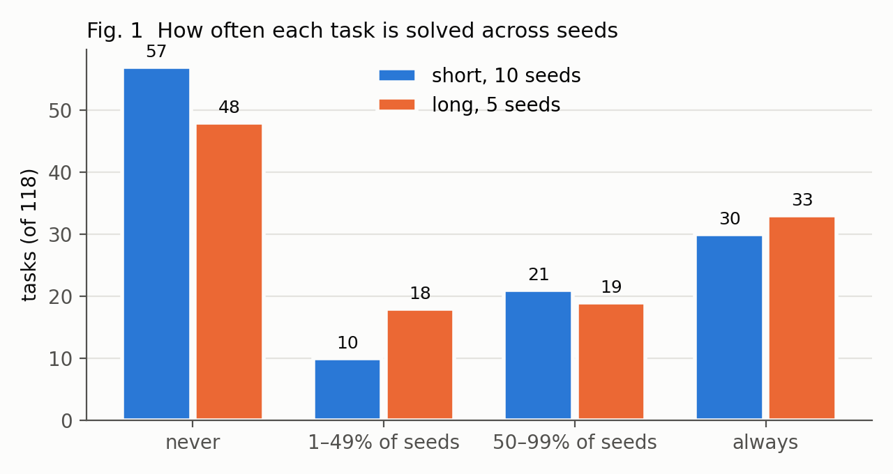
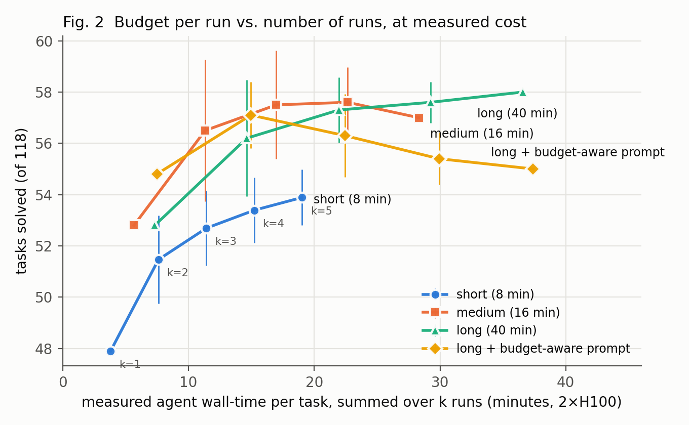
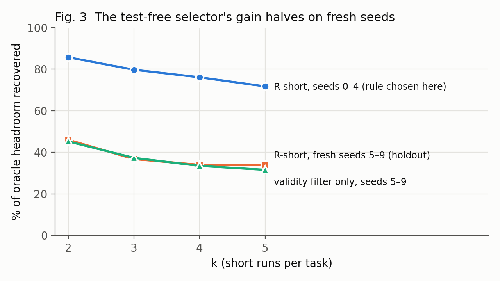

# More Seeds, More Steps, or a Better Pick? Where Test-Time Compute Pays Off for a Small Local Coding Agent

*Draft v0.4 (2026-11-02). All numbers come from files in `results/`; the source file is noted after each table. Code and per-run results: https://github.com/HRDevelops/gemma4-compute-allocation*

**Abstract.** A small agent running on local hardware gets a fixed compute allowance per task. Should that compute go to one run with a larger budget, or to several short runs with one patch picked without tests? We study this for Gemma 4 31B on the 118 gradeable tasks of the Gemma 4 Developer Agent competition, using 2,950 agent runs across four budget regimes. We count cost as what the runs actually spent, not the nominal budget. At every cost level, a larger per-run budget matches or beats sampling more short runs. One long run is within noise of five short runs plus selection, at 2.6× less compute, mostly because fewer runs end without a usable patch. Test-free selection looked strong on the seeds it was tuned on, but a pre-registered holdout cut its gain in half, to no more than a validity filter. Gemma 4 judging its own patches added nothing. One run's score carries ±5 tasks of seed noise. We release an Apptainer grader that fixes three silent scoring faults in the public setup.

## 1. Introduction

Competition agents for this track run a 31B model on four L4 GPUs, under an 8-minute, 28-tool-call limit per task. Within such a fixed allowance, there are two standard ways to buy accuracy with test-time compute:

- **Sample more:** run the agent several times and keep one patch, as in repeated sampling and best-of-n verification [2, 5, 6].
- **Think longer:** give a single run more time and tool calls [3].

Large-model studies report strong gains from sampling, but they pick the patch with hidden or generated tests, or with a trained verifier. Whether either approach pays off for a *small local* model, with *no* test oracle and a hard budget, is an open empirical question. So is how one would even measure it, given that one evaluation of an agent is noisy [7, 8].

We answer it on the competition's own tasks and harness, with four contributions:

1. **A reproducible grader.** It needs no root access and matches official scoring on gold and empty patches. It documents three faults in the public setup that silently inflate or deflate scores (§2).
2. **A noise model for agent leaderboards.** It gives the minimum detectable difference as a function of the number of seeds (§3).
3. **A matched-cost frontier** over four budget regimes and 1–5 samples per task, with cost measured from the runs themselves (§4).
4. **A pre-registered holdout test of test-free patch selection,** including Gemma 4 judging its own patches (§5).

The headline: **spend compute on budget per run, not on more samples.** The extra budget mostly goes unused, yet it removes the runs that would have produced nothing usable, and a selector without tests cannot make up for that.

---

## 2. Setup

**Tasks.** We use the 129 public tasks of the Gemma 4 Developer Agent competition. They are real GitHub issues from fastapi, rich, requests and httpx. A task counts as resolved when the repository's hidden tests pass on the agent's patch. To find the gradeable tasks, we applied each task's reference ("gold") patch and an empty patch:

- gold patches resolve 120/129;
- empty patches resolve 2/129.

The 118 tasks where gold passes and empty fails are our benchmark. Labels agree with a community audit on 117/129 tasks and were identical on a rerun. The 118 tasks split into fastapi 60, rich 45, requests 12 and httpx 1.

**Grader.** The official harness expects Docker; our cluster offers only rootless Apptainer, so we wrote a drop-in container manager that keeps the harness's Docker code path unchanged. Scoring correctly also meant fixing three faults in the public setup that give wrong scores without any error:

1. **Package shadowing.** The bundled wheels include released versions of the four target projects, which shadow the repository under test. Before our fix, 38 tasks "passed" with an empty patch.
2. **Version drift.** The bundle ships many versions of some dependencies (56 of starlette), and installation always picks the newest. Old FastAPI snapshots then fail against starlette 1.x. We pick, per task, the newest version that satisfies the repository's own constraints *and* was released before the task's creation date.
3. **Stale cache.** The harness caches the unpacked site-packages tarball under a fixed name in the temp directory. Concurrent or successive jobs then silently reuse a wrong environment. We give each job its own temp directory.

**Agent and model.** We hold fixed the public "Budget-Fit" agent (shell, file-edit and code-graph tools; a prompt asking for a fast, minimal fix) and vary only its budget. The model is Gemma 4 31B (QAT, w4a16), served by vLLM 0.19.1 with the competition's flags (Gemma 4 tool and reasoning parsers, 32k context, bfloat16, context caching and event compaction). Sampling uses temperature 0.2, top-p 0.95, thinking budget 4,096, and a fixed seed per run. We use two H100s per server (tensor parallel 2) where Kaggle uses four L4s, and run 10 tasks concurrently.

**Budget regimes.** The harness enforces three limits: wall time, tool calls and model turns. We test four configurations:

| Regime | Time | Tool calls | Turns | Seeds |
|---|---|---|---|---|
| short (competition default) | 8 min | 28 | 80 | 10 |
| medium | 16 min | 56 | 160 | 5 |
| long | 40 min | 140 | 400 | 5 |
| long + budget-aware prompt | 40 min | 140 | 400 | 5 |

*Table 1. Budget regimes. 2,950 runs in total.*

The budget-aware prompt changes one sentence. The original asks the agent to finish "in the minimum number of tool calls (under 8–10 turns)". The replacement states the budget and asks the agent to reproduce the bug and check edge cases before submitting.

**Cost.** Budgets are ceilings, not costs. We therefore measure what each run actually spent: agent wall time, generated tokens and tool calls. The cost of a k-run strategy is the sum over its k runs. Wall time and generated tokens give the same ratios between regimes (§4), so we report minutes.

## 3. How noisy is one run?

Figure 1 shows how often each task is solved across seeds.

*Figure 1. Tasks grouped by the share of seeds that solve them. With 10 short seeds, 31 tasks (26%) flip at least once. With 5 long seeds, 37 tasks flip.*

Nearly half the tasks are never solved (57 short, 48 long), and about a quarter are always solved. The rest flip between seeds. Those flipping tasks are what makes a single score noisy, and they are also the only tasks any selection method can gain on.

To quantify the noise, we model each task as a coin with its own resolve probability *p_t*, estimated from the seeds. The variance of one run's score is then Σ *p_t*(1 − *p_t*). The model's predicted spread matches the observed spread across seeds (2.35 vs 2.85 tasks for short).

| Regime | Mean solved | SD across seeds | 95% interval of one run | Min. detectable difference, 3 / 5 seeds per arm |
|---|---|---|---|---|
| short | 47.9 | 2.9 | ±4.6 | 5.4 / 4.2 |
| medium | 52.8 | 4.1 | ±5.7 | 6.6 / 5.1 |
| long | 52.8 | 3.4 | ±5.8 | 6.8 / 5.3 |
| long + prompt | 54.8 | 1.1 | ±5.3 | 6.2 / 4.8 |

*Table 2. The minimum detectable difference is computed at 95% confidence and 80% power. Source: `results/noise.txt`.*

A single submission can't reliably separate configurations that differ by fewer than about 9 tasks (7.5 accuracy points). Even with five seeds per arm, differences under 4–5 tasks stay out of reach. Several effects below are this size, so we report paired confidence intervals rather than rank point estimates.

## 4. Budget per run vs. number of runs

With fixed compute, should we buy one run with a larger budget, or several short runs and keep one patch, picked by the frozen test-free selector of §5? Figure 2 plots tasks solved against measured cost for each regime, at k = 1 to 5 runs per task.

*Figure 2. Each point averages over all k-subsets of that regime's seeds. Error bars are the SD across those subsets. Short runs carry k labels; the other lines follow the same left-to-right order. Source: `paper/figs/fig2_data.csv`.*

**Budget matches or beats extra samples at every cost level.** The short-run line lies below the other three everywhere. One medium run costs 5.7 minutes and one long run 7.3; both solve 52.8 tasks. Two short runs plus the selector cost 7.6 minutes and solve 51.5. Five short runs plus the selector cost 19.0 minutes, 2.6 times as much as one long run, and still don't clearly beat it: 53.9 vs 52.8. Every matched-cost comparison except the last points the same way, and two exclude zero:

| Comparison (matched measured cost) | Difference in tasks | 95% CI |
|---|---|---|
| medium ×1 − short ×1 (medium costs 1.5×) | +4.9 | [+1.6, +8.5] |
| medium ×1 − short ×2 + selector (medium cheaper) | +1.3 | [−1.8, +4.9] |
| long ×1 − short ×2 + selector (~7.5 min) | +1.3 | [−1.8, +4.6] |
| long + prompt ×1 − short ×2 + selector | +3.3 | [−0.2, +7.2] |
| long ×2 + selector − short ×4 + selector (~15 min) | +2.8 | [−1.1, +7.0] |
| long + prompt ×2 + selector − short ×4 + selector | +3.7 | [+0.1, +7.8] |
| long ×1 − short ×5 + selector (short costs 2.6×) | −1.1 | [−4.7, +2.6] |

*Table 3. Paired bootstrap over tasks, using per-task means over all seed subsets. Source: `results/paired_tests.txt`.*

The medium budget reaches the long budget's single-run score at 23% less measured cost. Most of the gain from a larger budget arrives by doubling it.

**Why a bigger budget helps: fewer wasted runs.** A larger budget mostly prevents the agent from ending without a usable patch. We call a run *invalid* if its patch changes no source file or it hits a budget limit. Invalid runs never resolved a task, in any regime. Their share falls from 20% of short runs to 9% of medium runs and 4% of long runs. In the short regime, 8% of runs hit the 8-minute limit.

The extra budget is mostly not spent, however. The median long run stops after 4.5 minutes and 29 tool calls, close to the short regime's 3.1 minutes and 25 calls. Only 14 of 590 long runs hit any limit. Measured cost grows 1.9× (and generated tokens 2.0×) for a 5× larger budget. **A larger budget acts as insurance for the minority of tasks that need it, not as a tax on every task.** That is why it wins at matched *measured* cost.

**Telling the agent its budget helps a little, at no extra cost.** The budget-aware prompt barely changes run length: 7.5 vs 7.3 minutes, and 31 vs 29 median calls. Its single runs score 54.8 against 52.8 for the plain long prompt (+2.0, CI [−1.4, +5.4]). Its spread across seeds is by far the lowest of any regime (SD 1.1 vs 3.4 tasks over 5 seeds). That suggests more careful work rather than more work, but the gain itself is not significant.

**Gains are spread across repositories.** Comparing a single long run with a single short run, fastapi gains 3.2 tasks of 60 and rich gains 1.8 of 45, while requests is already near its ceiling (10.7 of 12). The result is therefore not driven by one project.
## 5. Picking a patch without tests

Several runs only help if we can tell which patch is right without the hidden tests. The ceiling is high. For long runs, an oracle that always picks a correct patch reaches 65.8 tasks at k = 3 and 70.0 at k = 5, against 52.8 for one run. For short runs it reaches 58.1 at k = 5, against 47.9.

**Selectors.** Each selector scores a task's candidate patches using only the patch and the agent's trace. Ties are broken uniformly at random, and we report the exact expected number of tasks solved. We tried:

- **Validity.** Drop invalid runs (defined in §4).
- **Trace signals.** Whether the last command after the final edit exited 0; patch size; number of tool calls.
- **Consensus.** Similarity of a patch's changed source lines to the other candidates' patches.
- **Gemma 4 as judge.** Two variants:
  - *Pointwise:* the model scores each patch from 0 to 10 against the issue text, averaged over 3 samples.
  - *Listwise:* the model sees all candidates in random order and names the best one, again over 3 samples.
**In-sample, simple rules look strong.** On short seeds 0–4, the best combination was named R-short: drop invalid runs, prefer runs whose last command after the final edit succeeded, then take the smallest patch. It recovers 72% of the headroom at k = 5 (+7.6 tasks, CI [+3.6, +11.8]). The Gemma judges add nothing beyond this:

- the listwise judge reaches 62%, the same as patch size alone;
- the pointwise judge reaches 41%, no better than the validity filter alone (39%);
- adding the listwise judge as a tie-breaker to the execution signal changes nothing (55.1 vs 55.2).

**On fresh seeds, only the validity filter's gain survives.** Because R-short was chosen after looking at seeds 0–4, we froze it in a written pre-registration and ran five new short seeds (5–9). Figure 3 shows the result.

*Figure 3. Share of the oracle headroom recovered, (selected − single run) / (oracle − single run). Source: `paper/figs/fig3_data.csv`, `results/prereg_holdout.txt`.*

On the holdout seeds:

- R-short recovers 34–46% of the headroom: +2.9 tasks at k = 2 (CI [+0.7, +5.2]) and +3.6 at k = 5 (CI [−0.2, +7.6]).
- That is half its in-sample value.
- It is indistinguishable from the validity filter alone (50.8 vs 51.0 at k = 5).

The trace signals that looked useful were largely fitted to the noise of five specific seeds. The same happened to a pattern we had noticed in-sample, that the best signals differ between short and long runs. On the long runs that include held-out seeds, the frozen short-run rule does as well as the rule tuned for long runs: +4.6 vs +4.3 tasks at k = 3. On budget-aware runs, the frozen rule even hurts beyond k = 2: at k = 5 it picks 55.0 tasks, below the validity filter alone (56.4).

**Selection, not generation, is the bottleneck.** At k = 5, long runs contain a correct patch for 70 tasks, but our best selector finds 58. Twelve tasks are lost purely to choosing wrong. Neither cheap trace signals nor the same model acting as its own judge close this gap. For a small local agent, extra runs therefore pay off mainly through the validity filter. The rest of their potential waits on a better verifier: one that executes code, such as agent-written reproduction tests, or a stronger judge model.

## 6. What this means for competitors

1. **Raise the budget before adding runs.** Unused budget costs nothing; an unusable run costs a full attempt. Measure your share of unusable runs: on H100 it is 20% at the default budget (8% from the time limit alone), and higher on L4.
2. **If you sample, filter, and don't over-engineer the pick.** Dropping unusable runs is free and captures nearly all of the out-of-sample gain we could find. Hand-tuned trace rules and same-model judges did not generalize.
3. **Don't trust a single score.** One submission's score moves by about ±5 tasks across seeds. A local comparison needs three to five seeds per configuration and a paired test before a 5-task difference means anything. Tune on one set of seeds and confirm on another.
4. **Small prompt changes are cheap to test this way.** Telling the agent its real budget cost almost nothing and may help (+2.0 tasks, not significant). It is the kind of change that needs the noise discipline in point 3 to be confirmed.

## 7. Limitations

- **One model, one agent, one task pool.** We study Gemma 4 31B with the public Budget-Fit agent. The 118 tasks come from four repositories, and fastapi and rich make up 89% of them.
- **Holdout seeds, not holdout tasks.** The selector holdout uses new seeds on the same tasks. Holding out tasks would probably shrink its gain further.
- **Hardware.** We run on 2×H100 instead of Kaggle's 4×L4. Absolute times differ, and the 8-minute limit binds more often on L4. We expect this to favor larger budgets even more, but we did not measure it.
- **Five seeds per larger budget.** With 5 seeds, differences of about 2 tasks between the medium, long and budget-aware regimes remain unresolved.
- **Cost measure.** Wall time depends on server load; we hold concurrency fixed at 10. Generated tokens give the same ratios, but neither captures memory cost or prefill.
- **A weak judge.** Our judge is the same 31B model with a short prompt. A stronger or execution-based verifier may close part of the 12-task selection gap.

## 8. Related work

SWE-bench [1] set the format of these tasks. On the sampling side, repeated sampling raises coverage roughly log-linearly with the number of samples [2], and SWE agents exploit this with test-based or verifier-based selection [4, 5, 6]. Our setting removes both the tests and the trained verifier, and finds the coverage gain largely unrecoverable. On the budget side, compute-optimal test-time scaling [3] shows that the best allocation depends on problem difficulty. At a much smaller scale, we find a clear preference for budget over samples, driven by run failures rather than reasoning depth. Finally, work on agent evaluation argues for cost-aware comparisons [7] and error bars on benchmark scores [8]. We apply both to a live competition and show how large its single-run noise is.

## References

1. C. E. Jimenez et al. SWE-bench: Can Language Models Resolve Real-World GitHub Issues? ICLR 2024.
2. B. Brown et al. Large Language Monkeys: Scaling Inference Compute with Repeated Sampling. arXiv:2407.21787, 2024.
3. C. Snell et al. Scaling LLM Test-Time Compute Optimally can be More Effective than Scaling Model Parameters. arXiv:2408.03314, 2024.
4. C. S. Xia et al. Agentless: Demystifying LLM-based Software Engineering Agents. arXiv:2407.01489, 2024.
5. R. Ehrlich et al. CodeMonkeys: Scaling Test-Time Compute for Software Engineering. arXiv:2501.14723, 2025.
6. J. Pan et al. Training Software Engineering Agents and Verifiers with SWE-Gym. arXiv:2412.21139, 2024.
7. S. Kapoor et al. AI Agents That Matter. arXiv:2407.01502, 2024.
8. E. Miller. Adding Error Bars to Evals: A Statistical Approach to Language Model Evaluations. arXiv:2411.00640, 2024.
